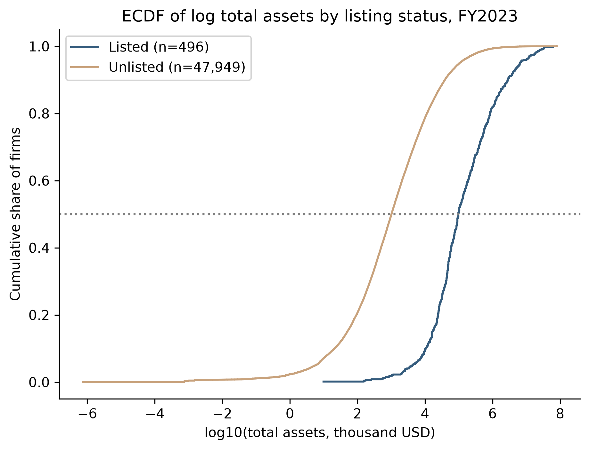
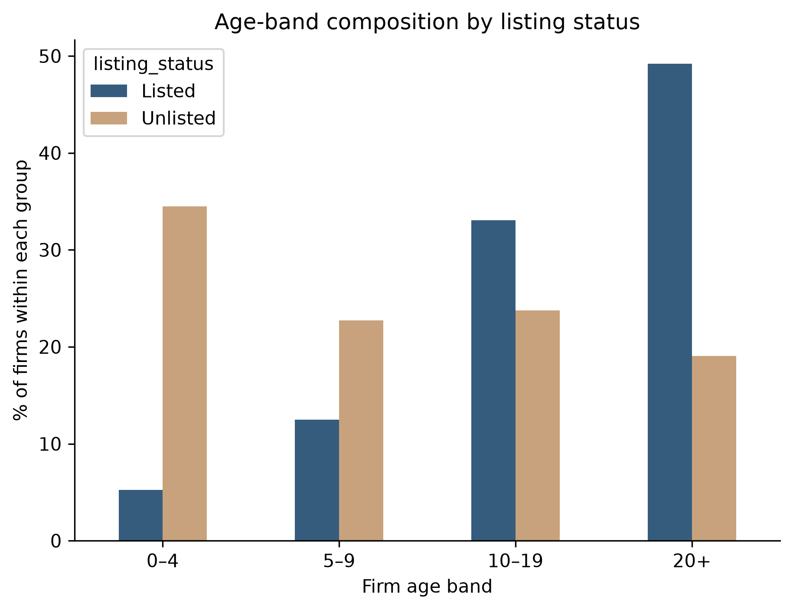

# Beyond the Median: Listed and Privately Held Singapore Firms

**DS607 Statistics for Data Science - MDSE Group Project**

## Group members

- Su Liangyu, 01564113
-  Nicolyne Tiana Lie, 01577376
- Jiang Minglan, 01548385

This repository is the report for an MDSE group project. It contains the data-preparation code, exploratory analysis, statistical inference, robustness checks, aggregate outputs, and reproducibility instructions.

## Inference question

Among active non-financial Singapore firms with FY2023 financial data, are listed firms larger than comparable privately held firms after matching on industry, firm age, and consolidation status, and is any remaining size gap concentrated in the upper tail of the firm-size distribution?

## Motivation and objective

A comparison of means or medians alone can hide where two firm-size distributions differ. A small number of very large listed firms might generate a large raw gap even if most listed and private firms are similar. Conversely, listing-status differences may persist across the distribution after accounting for observable differences in industry, age, and financial-statement consolidation.

The project therefore has three objectives:

1. compare the unadjusted firm-size distributions of listed and unlisted firms;
2. estimate the remaining size gap after constructing more comparable matched sets; and
3. determine whether the gap is broad or concentrated in the upper tail.

The analysis is associational. It does not estimate the causal effect of becoming listed.

## Data source, sample, and access

The data were extracted from **Orbis (Bureau van Dijk / Moody's)** through SMU's institutional licence. The extract is a Singapore cross-section using Orbis FY2023 financial fields and was pre-filtered to non-branch, non-financial firms recorded as active. NACE Section K (financial and insurance activities) was excluded.

The merged extract contains 48,995 firms: 496 listed and 48,499 unlisted. The analysis flags and excludes 2,041 unlisted firms whose immediate shareholder or global ultimate owner is a sampled listed firm. The positive-total-assets analysis sample subsequently contains all 496 listed firms and 45,952 unlisted firms.

The primary outcome is the natural logarithm of total assets in USD. Operating revenue is used as an alternative outcome. Employee count is not analysed because only three unlisted firms in the post-exclusion sample have recorded employee data.

### Licence and sharing restriction

The Orbis files are licensed firm-level data. This repository and any folder containing the extracts **must remain private and restricted to authorised project members**. Do not publish, redistribute, or upload the firm-level extracts to public repositories or public AI systems. No passwords or account credentials are stored in this repository.

An authorised SMU user reproducing the extraction should obtain the following Orbis fields: BvD ID, listing status, NACE Rev. 2 core code, consolidation code, incorporation date, FY2023 total assets, FY2023 operating revenue, FY2023 employees, country code, branch and active status, immediate-shareholder and global-ultimate-owner BvD IDs, and FY2023 closing date. See [`data/README.md`](data/README.md) for the expected local file names and access restrictions.

## Statistical methods

### 1. Exploratory and unadjusted comparison

- descriptive statistics, histograms, ECDFs, and boxplots;
- industry, age-band, and consolidation-status comparisons; and
- a two-sample Kolmogorov-Smirnov test of equality of the listed and unlisted log-assets distributions.

### 2. Matching

Each listed firm is matched without replacement to up to three unlisted controls from the same:

- NACE two-digit industry;
- firm-age band (0-4, 5-9, 10-19, or 20+); and
- broad consolidation status (consolidated or unconsolidated).

Within each stratum, controls closest in actual firm age are allocated round-robin, with random tie-breaking. Exact consolidation-code matching was infeasible because 495 of 496 listed firms were C1 whereas only one private firm was C1. All stochastic procedures use seed 607.

### 3. Matched inference

For matched set $i$, the analysis uses


where $A_i^{(L)}$ is the listed firm's total assets, $A_{ij}^{(P)}$ is the
total assets of private control $j$, and $m_i$ is the number of matched private
controls in set $i$.

The project reports:

- a one-sided exact sign test of whether positive matched gaps occur more often than 50%;
- a one-sided within-set permutation test of the median gap using 9,999 permutations;
- a 95% percentile bootstrap confidence interval for the median gap using 5,000 matched-set resamples; and
- matched quantile gaps at Q25, Q50, Q75, and Q90, with equal total weight per matched set.

Exponentiating the median log gap gives a median within-set ratio. It is not the ratio of the two groups' marginal medians.

### 4. Robustness checks

- maximum listed-control age gaps of 15 and 10 years;
- operating revenue as an alternative outcome;
- removal of the largest 1% of firms separately within listing-status groups;
- one private control instead of up to three; and
- exclusion of implausibly small positive asset values below USD 1.

The proposed state-owned-firm exclusion could not be implemented because the extract contains no reliable state-ownership classification. State ownership was not inferred from company or owner names.

## Key results

| Analysis | Result |
|---|---|
| Unadjusted distribution | KS statistic = 0.706, p < 0.001 |
| Matching coverage | 351 of 496 listed firms matched (71%) |
| Age balance | SMD reduced from 0.874 to 0.107 |
| Direction of matched gaps | Listed firm larger in 300/351 sets (85.5%); sign-test p < 0.001 |
| Main median within-set ratio | 7.96; bootstrap 95% CI [6.07, 11.11] |
| Main permutation test | One-sided p = 0.0001 |
| Matched quantile ratios | Q25 8.38, Q50 7.81, Q75 10.57, Q90 8.51 |
| Operating-revenue robustness | Ratio 5.51; 95% CI [3.92, 7.46] |
| Excluding largest 1% | Ratio 9.25; 95% CI [6.79, 13.15] |
| One-control robustness | Ratio 9.17; 95% CI [6.72, 13.23] |
| Assets at least USD 1 | Ratio 8.24; 95% CI [6.50, 11.11] |
| Age gap at most 10 years | Ratio 6.87; 95% CI [5.38, 9.61] |

The unadjusted distributions differ substantially. After matching, listed firms remain materially larger, and the Q25-Q90 estimates are broadly similar rather than increasing only at Q90. The result also persists across the pre-specified outcome and outlier checks and the additional matching-specification checks. These findings support a broad conditional association between listing status and firm size, not a causal effect of listing.

Key aggregate outputs:

- [`matched_inference_summary.csv`](outputs/tables/matched_inference_summary.csv)
- [`matched_quantile_gaps.csv`](outputs/tables/matched_quantile_gaps.csv)
- [`matching_balance.csv`](outputs/tables/matching_balance.csv)
- [`robustness_outcomes.csv`](outputs/tables/robustness_outcomes.csv)
- [`robustness_matching_summary.csv`](outputs/tables/robustness_matching_summary.csv)

Selected figures:





Final presentation:

- [`DS607_GP_01548385_slides.pptx`](outputs/presentation/DS607_GP_01548385_slides.pptx)
- [`DS607_GP_01548385_slides.pdf`](outputs/presentation/DS607_GP_01548385_slides.pdf)

## Repository map

```text
.
├── README.md
├── AI_USAGE.md
├── CONTRIBUTIONS.md
├── requirements.txt
├── data/
│   ├── raw/orbis/          # restricted Orbis exports
│   ├── interim/            # merged restricted data
│   ├── processed/          # cleaned restricted data
│   └── README.md
├── src/
│   ├── 01_merge_orbis.py
│   └── 02_clean_data.py
├── notebooks/
│   ├── 01_eda.ipynb
│   ├── 02_matching_inference.ipynb
│   ├── 03_robustness_outcomes.ipynb
│   └── 04_robustness_matching.ipynb
└── outputs/
    ├── figures/
    ├── tables/
    └── presentation/      # final slide PDF
```

## Reproduction instructions

The recorded environment uses Python 3.14.7. From the repository root:

```bash
python3 -m venv .venv
source .venv/bin/activate
python -m pip install --upgrade pip
python -m pip install -r requirements.txt
```

If the restricted raw files are not already available, an authorised user must export them from Orbis and save the three parts under `data/raw/orbis/` using the names documented in [`data/README.md`](data/README.md). Then run:

```bash
python src/01_merge_orbis.py
python src/02_clean_data.py
```

Run the notebooks in this order, using the environment above as the notebook kernel:

1. `notebooks/01_eda.ipynb`
2. `notebooks/02_matching_inference.ipynb`
3. `notebooks/03_robustness_outcomes.ipynb`
4. `notebooks/04_robustness_matching.ipynb`

All paths are relative to the repository root or the `notebooks/` directory. Aggregate figures and tables are written to `outputs/`.

## Limitations

- The study is a single Singapore cross-section and does not identify a causal effect of listing.
- Orbis coverage of private firms may be incomplete, and missingness may be non-random.
- Matching adjusts only for observed industry, age, and broad consolidation status. Exact consolidation-code matching was not feasible.
- Only 351 of 496 listed firms could be matched. Results therefore apply to the common-support subset; unmatched listed firms are not represented in the main estimate.
- The subsidiary exclusion captures sampled listed firms identified as immediate shareholders or global ultimate owners, but may miss intermediate ownership links.
- The bootstrap resamples fitted matched sets and does not include uncertainty from selecting the matches themselves.
- A reliable state-ownership field was unavailable, so the proposed state-owned-firm exclusion was not performed.
- Employee-count coverage is insufficient for a credible employee-based robustness analysis.
- Firm-specific reporting dates and accounting practices may reduce comparability even within the FY2023 Orbis fields.

## Project documentation

- [`AI_USAGE.md`](AI_USAGE.md) documents the use and verification of generative AI assistance.
- [`CONTRIBUTIONS.md`](CONTRIBUTIONS.md) records the division of work.
- The final presentation PDF will be stored in `outputs/presentation/`.
